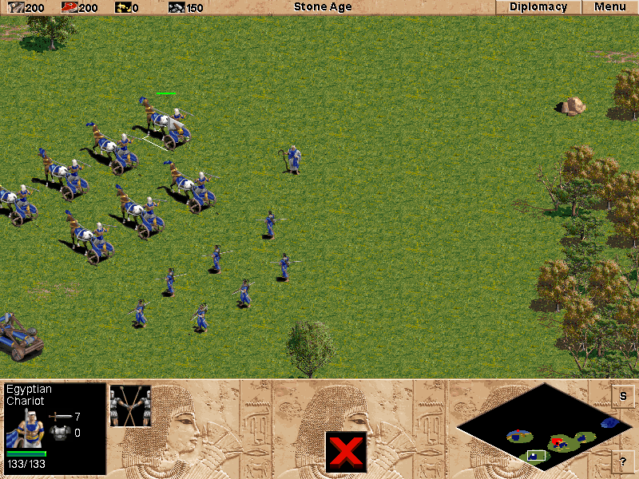

## Build an empire

Command Egyptian chariots and soldiers against the Greeks in the demo's combat showcase, or play the Reign of the Hittites campaign.

Choose **Single Player**, then **Campaign**, enter a name and pick a scenario. Click a unit to select it and right-click or click the map to order it.
