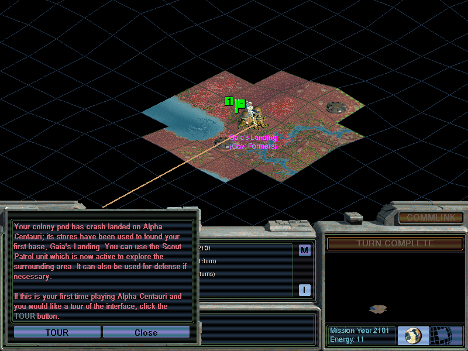

## Make planetfall

Choose a faction and build your first bases on Planet in this 100-turn demo.

Click **OK** on the introduction, choose **Quick Start**, then **OK** on the Planetfall briefing and base-name prompts. Move units with the keypad or mouse, and use **Turn Complete** to end your turn.
