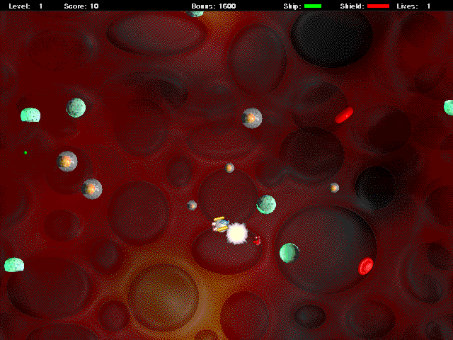

Choose **Later** to try the original unregistered game, then **Play** and a
scenario. The original Keyboard-only setup uses **Up** to thrust, **Left/Right**
to move and **Space** to shoot. The original trial provides two lives and stops
at level 15. Later levels, limit traversal, registration features, persistence and
sound fidelity remain unverified.

Native movement/firing and matched controls are verified. Hosted-browser input
and pacing, and released public play remain unverified.
