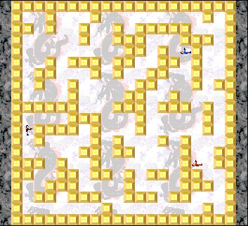

## Plan your strike

Every player secretly plots a turn of moves and shots. All the moves then play
out at once. Hunt your target through the maze while avoiding the assassin hunting
you.

Choose **Solo** and click **OK**, then **OK** on Game Setup. Click the arrow, gun
and look buttons below the maze to enter moves, then click the cycle arrow to
play the turn.
