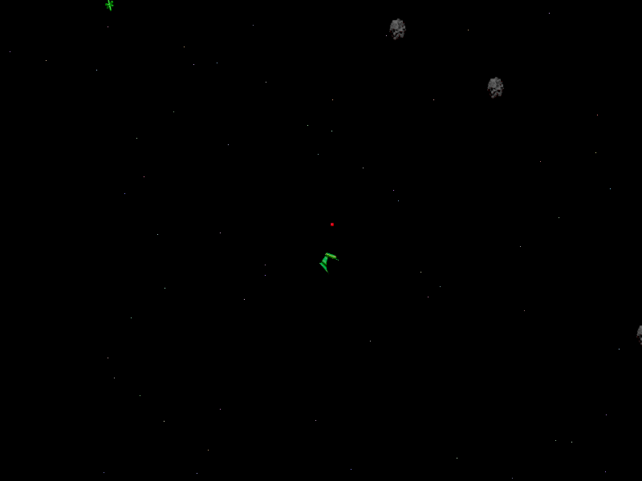

Choose **Begin Game — One Player**, then press **Control** to select a ship.
Use **keypad 8** to thrust, **keypad 4/6** to turn and **Control** to fire.
**Escape** returns to the menu. Later waves, purchases/upgrades, two-player play,
persistence and sound fidelity remain unverified.

Native movement/firing and matched controls are verified. Hosted-browser input
and pacing, and released public play remain unverified.
