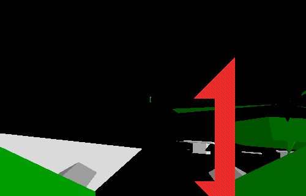

Pilot a **HECTOR**, a bipedal combat vehicle, through Avara's three-dimensional
missions. Use the arrow keys to move and turn, the mouse to aim, and its button
to fire. The **Window > Keyboard** editor lets you inspect and configure controls.

This is the original **Avara 1.0.1** shareware installer. Choose **Not Yet** at the
trial notice, enter a player name, select **Training Grounds**, click **Start
Server**, then choose **Game > Start**. The complete package retains its licence,
documentation, missions and editing tools. Its original 30-day trial terms apply.

Native testing covers mission loading, movement, turning and non-silent audio
output on the 68K route. Full missions, multiplayer and browser qualification
remain pending, so browser launch is disabled.
