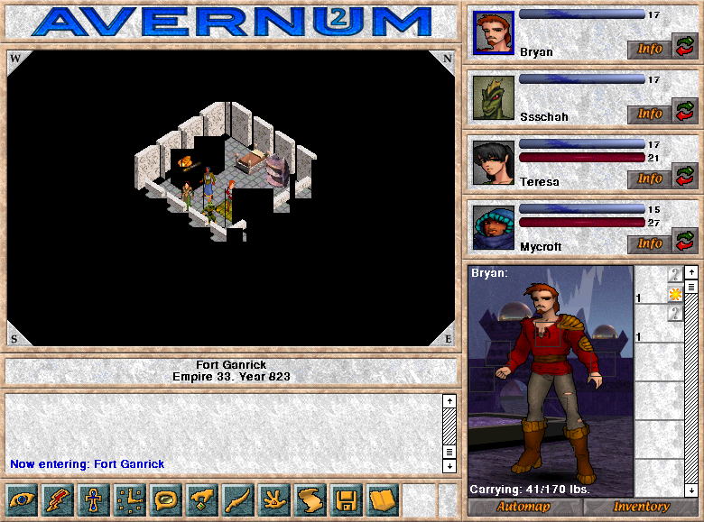

Begin at Fort Ganrick and guide a four-character party through subterranean
towns and caverns. Click the terrain or use the numeric keypad to move. This
is the original Classic Macintosh v1.0.2 demo with its manual, map and licence.
