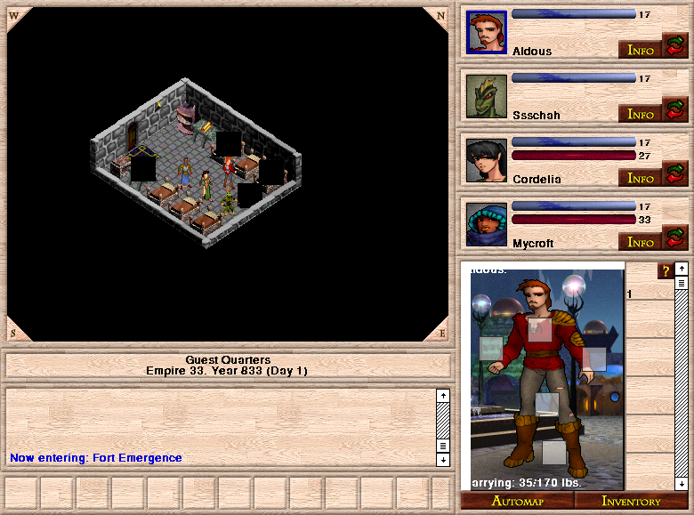

The original 2002 adventure begins in the Guest Quarters of Fort Emergence.
Create a party, explore the surface and investigate the plagues threatening its
towns. The unregistered demo contains the first quarter of the adventure and
retains its original shareware conditions.

This classic Macintosh v1.0.1 package has bounded native party-movement evidence.
Launch remains disabled while hosted-browser input, rendering and pacing are
qualified.
