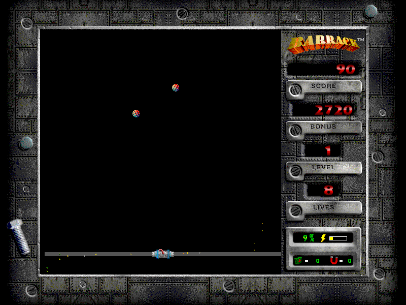

Move your barrier gun with the mouse and click to fire. Clear **80% of the arena**
to advance while keeping the bouncing balls away from your growing barriers.

This is the original **Barrack 1.0.4** shareware distribution. Choose **Not Yet**
at its original trial notice, then **Play Barrack**. The **Instructions** and
**Setup** buttons explain the other controls and let you configure them.

The complete installer retains its licence, registration program, documentation
and media. Its original 30-day trial terms still apply. Bounded native testing
covers menu entry, movement, a scored barrier and non-silent audio; browser
qualification is pending, so launch remains disabled.
