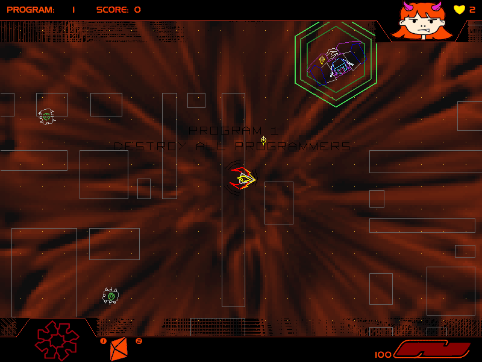

## Six programs against Terminus

Battle-Girl's original Macintosh demo includes levels **1, 2, 3, 5, 10 and 40**.
It retains one music track, 8-bit sound and the original demo's feature limits.
The complete package includes the publisher's README, ordering information and
Register utility.

Choose **Play** from the title screen. The original controls use the mouse for
movement and the keyboard for independent weapon directions: **W/A/S/D** and
**Q/E/Z/C**. **Space** fires an acquired secondary weapon. Native primary firing
is verified; browser play remains pending.

