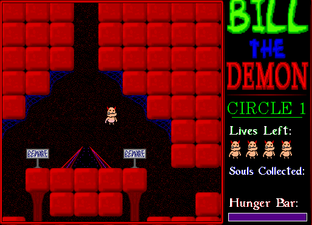

## A little demon with a loud voice

Click the title to dismiss it, then choose Game → New Game. Use A/D or Left/Right
to walk, W or Up to jump, and Space or Return to scream or eat. Screaming consumes
hunger; eating souls replenishes it. The complete original instructions accompany
the game download.
