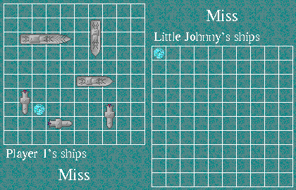

Choose an opponent, drag your ships into position, then click **Done**. Click the
opponent's grid to fire. The unchanged 1999 shareware game includes four
unregistered computer levels and its original 30-day trial.

Browser and released-runtime qualification are pending. The private native
candidate verifies opponent selection, ship movement, a shot and the computer's
reply. Victory, saving, two-human play and audio fidelity remain unverified.
