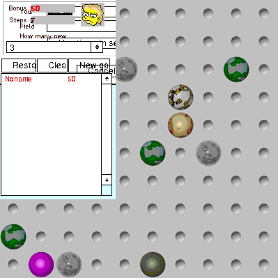

Play **Bubbles 1.3**, Maxym Runov's ball-line puzzle.
Choose **Continue** at the original colour advisory, then **File → New Game**.
Accept the Small field, then drag a ball to an empty
cell reachable through free spaces. Five matching balls in a line disappear and
add to your score; new balls arrive after other turns.

Native ball movement, translucent drag feedback, line removal and scoring are
verified. Browser launching is pending approval. The original unregistered
shareware restrictions remain: score saving and GameField Manager require
registration.

