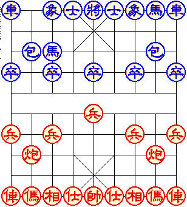

Drag a red piece to a legal destination to play against the Macintosh.
A soldier moves one rank forward before crossing the river. **Game → Configure
Game** chooses sides and timing; **Level** adjusts the computer's strength.
**File → New** starts again. The board's history slider steps through moves.

This is the complete original shareware package with its registration terms.
Native play verifies one soldier move and the computer reply. Startup rendering
fidelity, browser input/pacing, complete games, stronger levels, persistence and
sound fidelity remain unverified.
