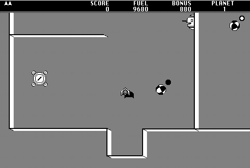

## Fly the planets

Steer your ship through each planet's gravity, destroy the bunkers and use your
shield to pick up fuel before you run dry. The game includes a planet editor for
building your own galaxies.

Choose **Game > Start Game**. By default, Option turns left, / thrusts, Shift
fires and Space raises the shield. Change the keys with **Game > Set Controls**.
