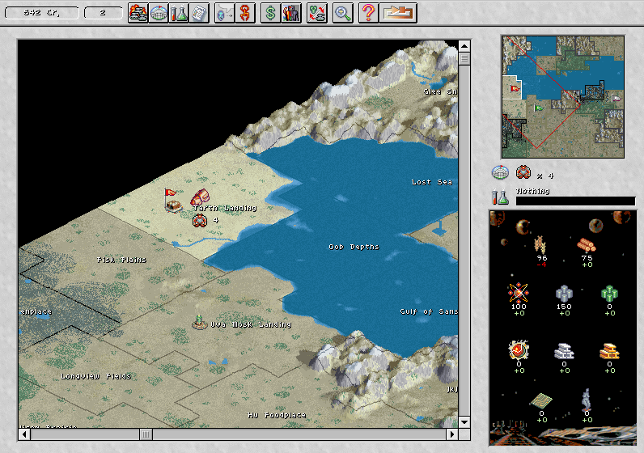

Choose Default for the window size, acknowledge the demo notice and press Space
at the title. Quick Start asks for a race and landing territory. Use the arrow at
the right of the toolbar to end a turn, then Done to close the event report.

The original solo demo ends after 40 turns and limits world sizes, difficulty
and other features. Saving and loading are disabled. Native testing verifies one
turn; browser play, extended campaigns and multiplayer remain unverified, so
browser launch stays disabled.
