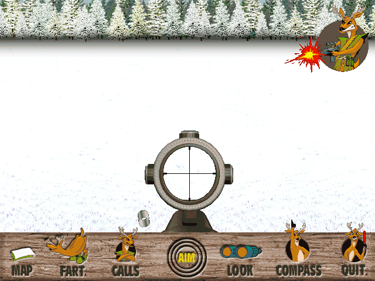

Play as Bambo in the original Macintosh **Deer Avenger** demo.

Choose **New Hunt**, select a weapon and hunting area, then choose a spot on the
map and click **Hunt**. Move the pointer to the edges to look around. Click
**Aim**, then click the view to fire; **Space** or **Escape** lowers the weapon.
The bundled ReadMe explains calls, binoculars and trophies.

Native startup and firing response are verified. Browser qualification remains pending.

