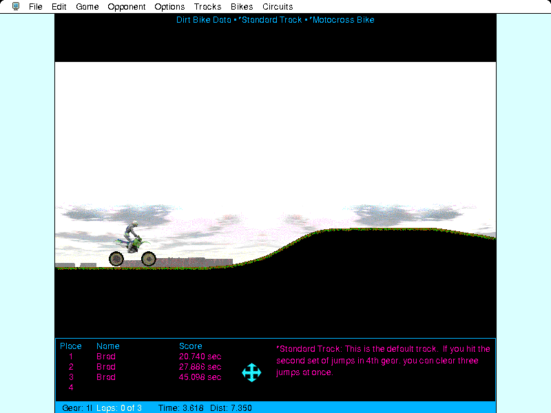

## Ride the track

Shift gears and balance your motocross bike over hills and jumps in this
physics-based racer. Race recorded opponents for the best time, or design your
own tracks and bikes.

Click **Not Yet** on the registration notice, then click to reach the start
line. Throttle depends on where the mouse is: at the top of the screen it is full
on, and at the bottom the brakes are full on. Press X or the mouse button to
shift up, and Z to shift down.
