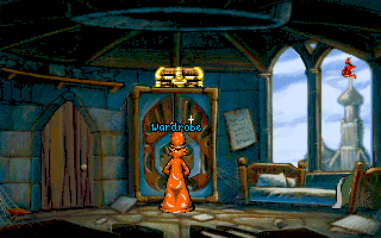

Play the original Macintosh **Discworld** demo. Press **Return** at the title and let the opening sequence finish before exploring Rincewind’s room. Follow the game’s visible cursor when selecting a destination.

Native startup and walking response are verified. Browser launch remains disabled pending browser qualification.

