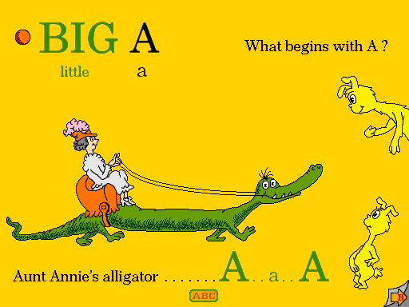

Explore a selection of alphabet pages in the original **Dr. Seuss’s ABC** Macintosh demo.

Choose **Let Me Play**, wait through the page narration, then click the characters and objects. On the A page, click **Aunt Annie’s alligator** to trigger its animation. This is a promotional selection of pages, not the complete retail book.

Native A-page interaction is verified. Browser qualification remains pending.

