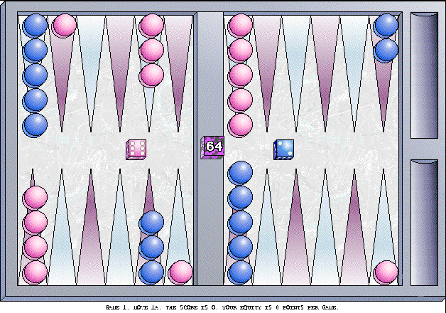

## Roll the dice

Race your checkers home and bear them off before the computer does. Use the doubling cube to raise the stakes.

Click the board to roll, then drag checkers to move them. Change the difficulty from the Level menu.
