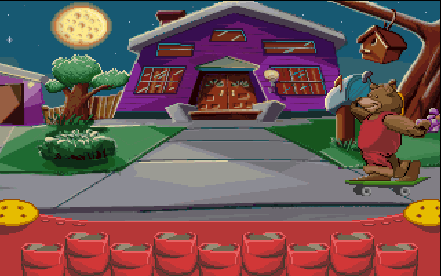

## A midnight surprise

Fatty Bear wants to surprise Kayla on her birthday. Explore the house, find what you need and get everything ready before morning.

Click on things to explore and interact. Use the inventory along the bottom of the screen.
