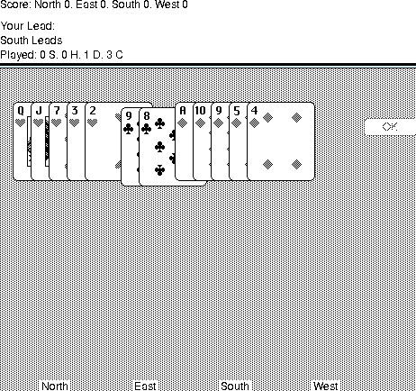

## Avoid the points

Enter player names and choose your input mode. Expert plays a card immediately
when clicked; Beginner lets you select before playing. Select three cards and
press Pass when asked. Follow the led suit whenever possible, and try to avoid
hearts and the queen of spades. The Help menu contains the original rules.
