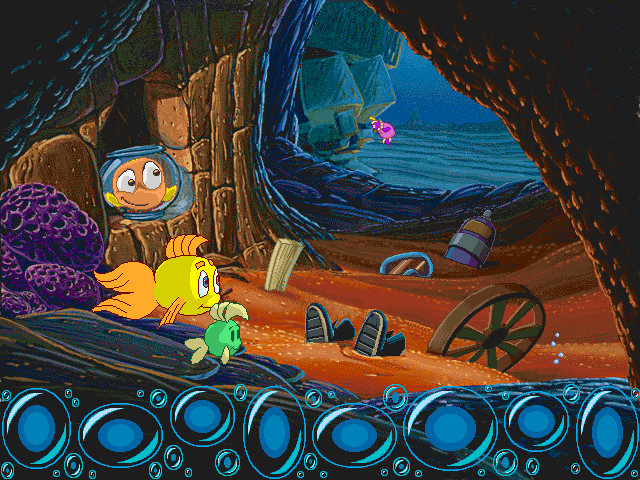

Point and click to explore an underwater mystery with Freddi Fish and Luther. This original Macintosh demo offers a small adventure from their search for the missing kelp seeds.

The complete original publisher demo and its readme are preserved. Native
interaction has been verified. Browser play is still being checked.
