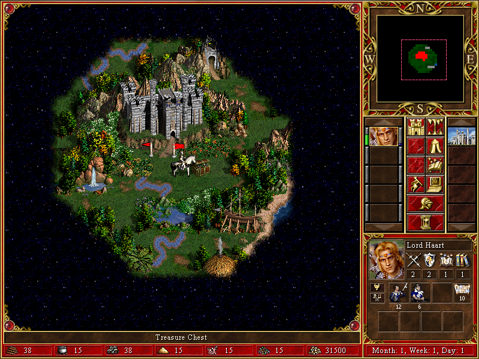

Explore a fantasy map, collect resources and lead armies in turn-based battles.
This preserves the original December 2000 Macintosh Complete demo.

A bounded native treasure interaction is observed: gold rises from 30000 to
31500 after taking the reward. An equal-duration omitted-confirmation control
retains the reward dialog and 30000 gold. This does not establish sustained play,
battles, saving/loading, audio fidelity or browser pacing. Launch stays disabled.

A private browser build reaches the demo menu, but ordinary New Game remains on
its loading screen through a 30-second welcome-dialog readiness bound. Scheduling
metrics pass during the measured loading window; that does not qualify browser
gameplay or sustained play. The cause and eventual completion remain unproven.
See the [browser checkpoint](https://github.com/benletchford/systemless/issues/5921).
