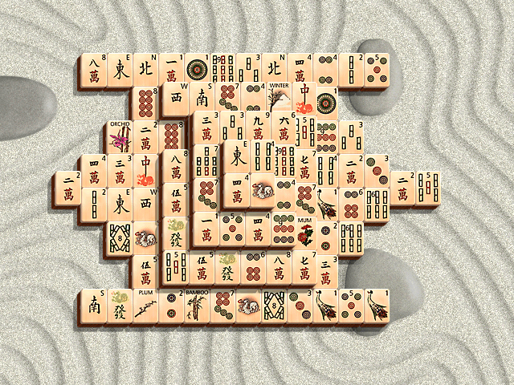

Open Zen Bones and find matching exposed tiles. A tile is exposed when it has no
tile above it and has a free left or right edge. Seasons can match other seasons;
flowers can match other flowers.

The original demo limits are preserved. Native matching is verified; browser
qualification is pending.
