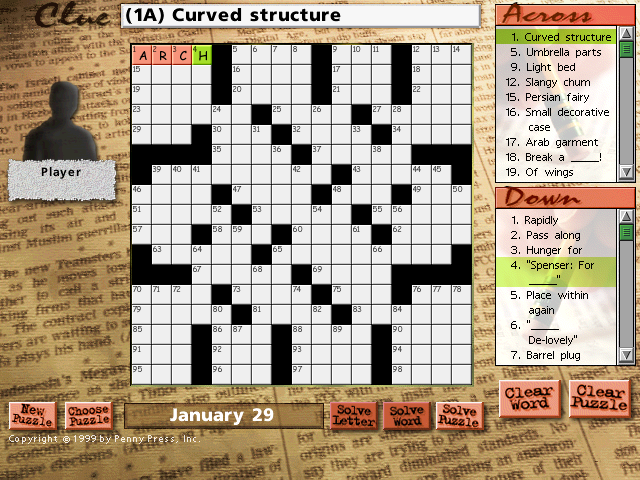

## Crossword time

Pick a word game from the hub and play. The crossword offers full Across and Down clue lists and hints, and lets you reveal a letter, word or whole puzzle.

Click a clue or square, then type your answer. Press the spacebar to switch between Across and Down.
