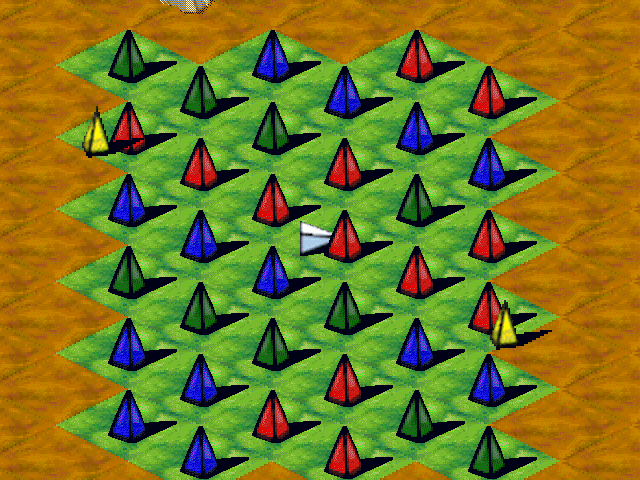

## Break the ice

Every level is a field of coloured pyramids. Some you can shatter directly, others must be tricked into hazards or lured by the seekers that chase you.

Steer with the arrow keys or the numeric keypad (including diagonals). Press P to pause.
