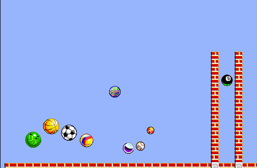

Also titled Professor Tim's Incredible Machines. Click the opening screen, choose
Done on the credits, wait for the parts to load, and keep the default Guest sign-in.
Choose the visible puzzle control, dismiss the tutorial heading and select
Actions > Run Puzzle to start the simulation.

The original demo and its English, French and German help applications are retained.
Browser qualification is pending; launch remains disabled.
