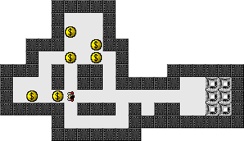

Use the arrow keys or click an adjacent square to move. Push each money bag
onto a destination; bags cannot be pulled. Hold **Shift** to move as far as
possible in one direction. **Edit → Undo** takes back a push;
**File → Restart Level** starts the puzzle again.

The original package includes fifty Default levels and thirty-five Extra levels.
Native movement and a push are verified against an omitted-input control.
Browser input/pacing, completed puzzles, other levels, persistence and sound
fidelity remain unverified.
