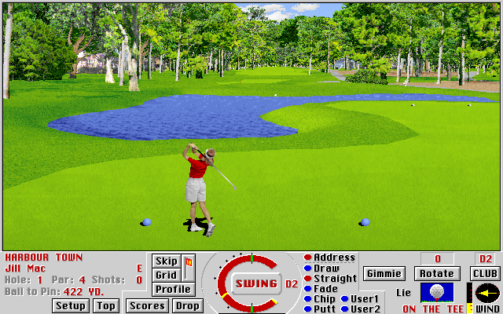

Play one Harbour Town hole in the original Macintosh **Links Pro** demo.

Choose **File → New Game**, select a golfer, click **Add**, then confirm the setup.
To swing, hold the **SWING** button for the backswing, release near the top of the
meter, then click again as the indicator returns to the bottom. The bundled
instructions explain club selection and shot timing.

A native shot and normal penalty/drop recovery are verified. Browser qualification
remains pending.

