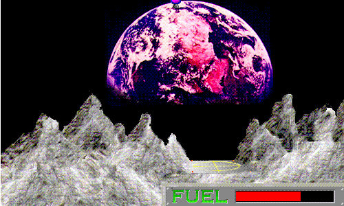

## Bring it down gently

Steer your lander between jagged peaks and touch down softly on the landing pad
before your fuel runs out. Higher gravity earns a bigger bonus.

Choose **File > New Game**. Press J or keypad 4 to rotate left, K or keypad 5 to
thrust, and press ? for help. Gravity and difficulty are set in the Options menu.
