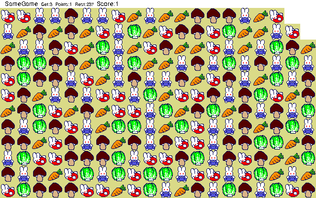

## Match the characters

Click a connected group of matching characters to select it, then click again to
remove it. Larger groups earn more points. Pieces fall into gaps, and empty
columns close from the right. The original documentation and character sets
accompany the game download.
