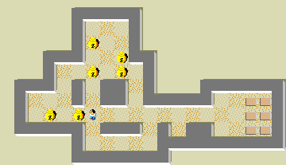

Choose **Add a new player** from **Players**, enter a name and accept. Dismiss the level banner, then use arrow keys or click adjacent squares to move and push bags. **Edit** offers undo and restart.

The bounded native replay verifies movement and a bag push, with an omitted-push control. Completed levels, external modules, saved progress and audio fidelity remain unverified.

Launch stays disabled pending hosted-original browser qualification and final source review.
