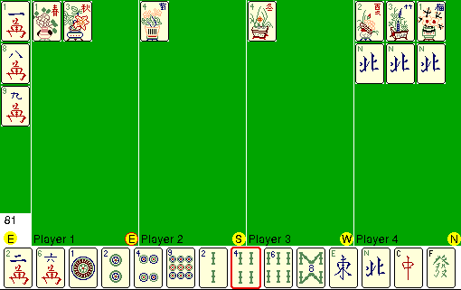

Play **Mahjong 1.0.5 International**, Matti Larborn's four-player game.
Choose **DEMO** in the original registration dialog, then **File → New Game**.
Leave Player 1 human and mark the other three players as Computer.
Click a tile in your hand to discard it and respond to any offered bids.

Trial setup, a player discard and computer responses are verified natively.
The original one-round trial, registration reminders and locked saves remain.
Browser launch is awaiting qualification.

