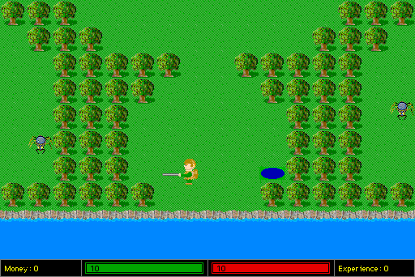

Saric survives a shipwreck on the way to Zarin. Explore the island, talk to its
inhabitants and find the Ambassador of Kieh.

Move with the arrow keys or numeric keypad. Hold **Command** while moving to
run, using stamina. Walk into people or signs to interact. Press **I** to open
inventory, select a weapon, then use **Space** to attack. **Shift** uses the
alternate action.

This entry is awaiting browser and released-runtime qualification. The native
candidate verifies the opening story, sailor interaction, dagger equipment and
thrust, and a map transition. Combat hits, longer progression, saving and audio
fidelity remain unverified.
