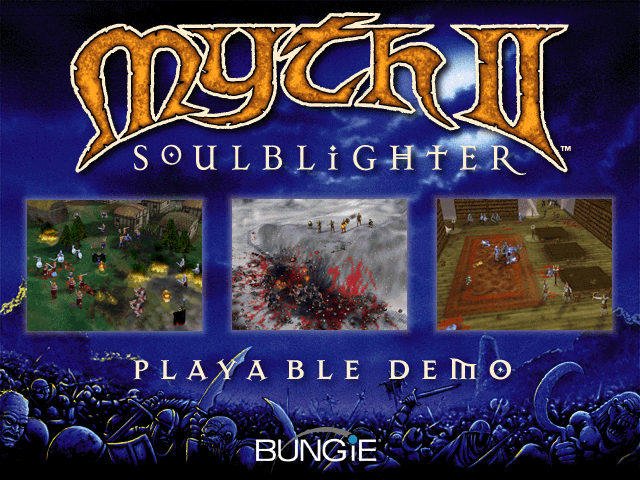

Command small groups of warriors, archers and dwarves across a three-dimensional
battlefield. The original demo describes a tutorial, two single-player levels
and one network map.

A bounded native documentation capture reaches the original PLAYABLE DEMO splash
after ordinary Return at 362 frontend/guest ticks, with zero assertions and zero
budget exhaustion. This documents the title screen only. The original PowerPC
executable, default CPU, partition, sound and initial display are preserved.
Tutorial loading (#4132), actual gameplay, browser pacing and audio fidelity
remain unqualified, so launch stays disabled.
