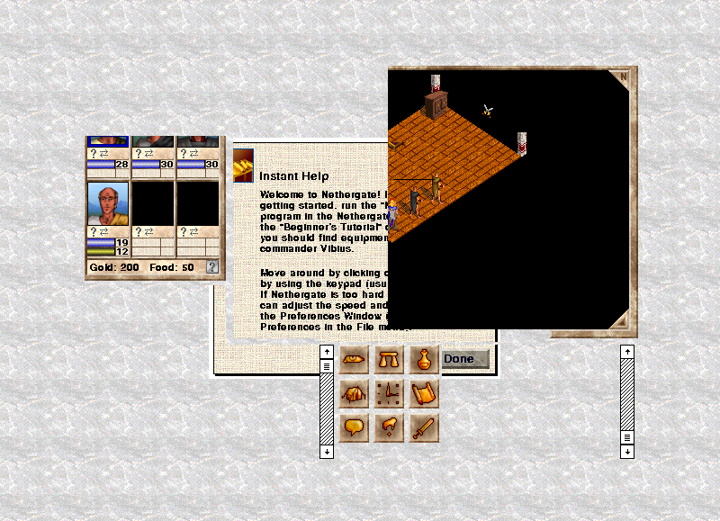

Choose the Roman or Celtic campaign, then guide your party through Britannia
with the mouse or numeric keypad. This is the original Classic Macintosh
v1.0.1 demo with its bundled manual, order form and licence.
