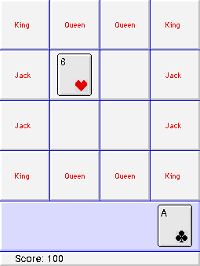

Use **File → New game** or **Command-N** to start. Place Kings, Queens and Jacks
in their labelled edge squares. Number cards may occupy the inner squares or
available edge squares. When the grid is full, remove combinations totalling ten.
Fill every face-card position to win; drawing an unplaceable face card ends the game.

This is the complete original **On the Edge 3.1** shareware package. Its original
readme and five-dollar shareware request remain intact. The default edition uses 68K.
