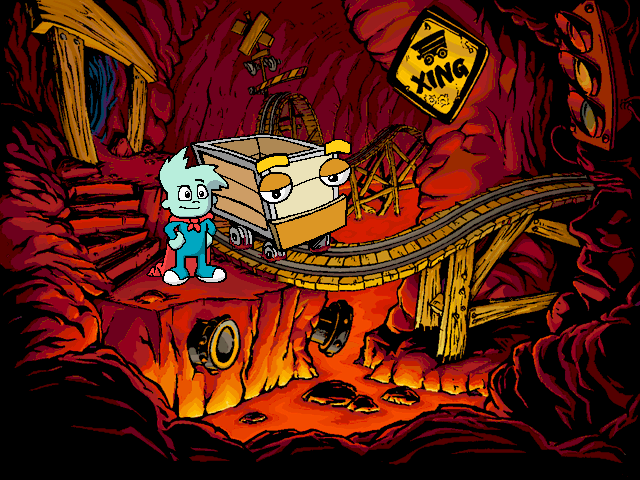

Meet **Pajama Sam** in the Land of Darkness in this original Macintosh demo.
The complete publisher package includes its original Readme and bundled components.

The publisher describes point-and-click exploration, inventory items and **Escape**
to fast-forward the current cutscene. Native navigation along the left path to the mine-cart room is verified.
Browser play remains pending.

