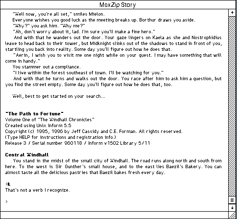

## Read, then type

Set out from the city of Windhall on a fantasy quest in the first volume of The Windhall Chronicles.

Type commands such as LOOK, EXAMINE DOOR or GO NORTH and press Return. Type HELP
or ABOUT for the game's own instructions.
