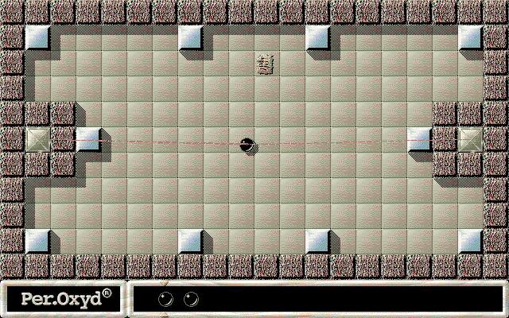

## Another world of marbles and stones

Roll the marble around each landscape, avoiding obstacles while uncovering
pairs of matching Oxyd stones. This is the original Macintosh follow-up to
Oxyd, with its own landscapes and presentation.

Press **F1** for single-player mode, then use the normal mouse confirmations to
begin the first landscape. Move the mouse to guide the marble. The original
shareware and landscape-code requirements remain intact.

