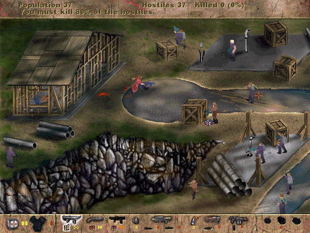

Play the Construction Site in the original Macintosh **Postal** promotional demo.
The package includes one single-player level with three difficulty layouts, one
multiplayer level and one challenge level.

Press **Return** to continue the opening screens, then choose **Start → Single
Player → New**. Use the arrow keys to move and turn. The bundled release notes
describe the other controls and game modes.

Native level entry and movement are verified. Browser qualification remains pending.

