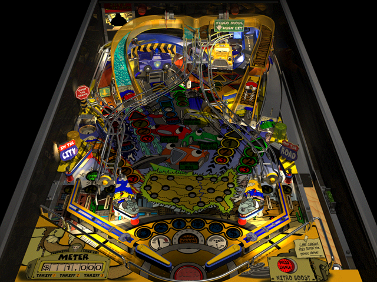

## Coast to coast

Drive a cab across the United States by hitting ramps, targets and the city map on a detailed pinball table. Multiball, video modes and a dot-matrix display complete the arcade feel.

Press S to start. Use the keyboard flipper and plunger keys set in the options; Return launches the ball.
