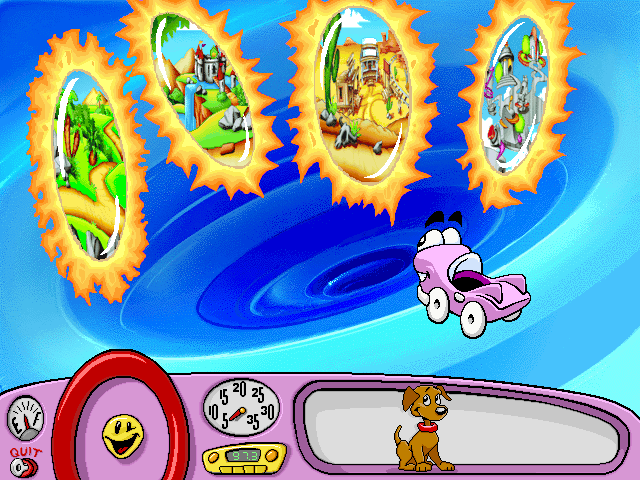

Join Putt-Putt and Pep on a trip through time. Choose the prehistoric portal, explore the past, and look for Putt-Putt’s missing history report.

The complete original publisher demo and readme are preserved. Native
navigation is verified. Browser play is still being checked.
