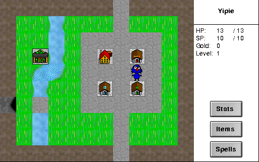

Create a character and explore the town and surrounding lands. Use the keyboard
to move and encounter monsters, shops and treasures. This is the original
shareware edition; its registration limits remain in place.

The character-selection portraits currently appear blank, though their locations
can be clicked. Browser gameplay, combat and saved games remain unverified.
