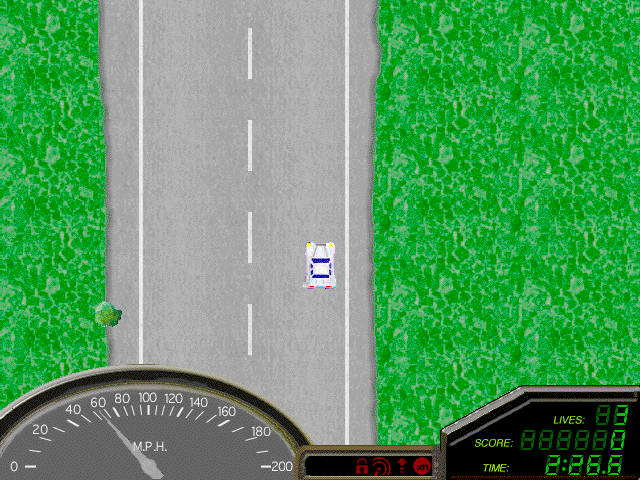

Drive through traffic, skid around bends and try to reach the end of each road.
This entry preserves the original 1.1 shareware package, including its Readme and
registration helper. Its first-three-level trial remains intact.

Native throttle input is verified. Pink sprite-edge pixels still need rendering
review, and browser play and performance remain unverified. Launch stays disabled.
