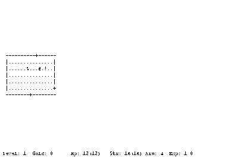

Play the original **Rogue III Mac release 6**, ported to the Macintosh by Rick
Holzgrafe. The complete publisher archive includes the original manual and port
README. This edition contains a 68K game.

Use **H**, **J**, **K** and **L** to move left, down, up and right. Lowercase moves
one cell; uppercase continues until something stops you. See the bundled manual
for inventory, item use and other dungeon commands.

This product includes software developed by the University of California,
Berkeley and its contributors. The complete BSD conditions and disclaimer are
retained in the original Rogue Manual supplied with the game.

Native first-dungeon movement is verified. Browser qualification, broader
progression, combat, saving and audio remain pending.

