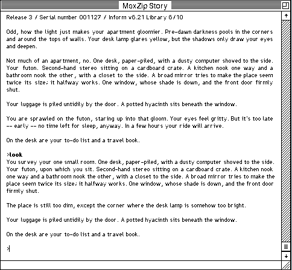

## Read, then type

Wait out the pre-dawn hours in your gloomy apartment in Andrew Plotkin's unsettling one-room text adventure.

Type commands such as LOOK, EXAMINE DOOR or GO NORTH and press Return. Type HELP
or ABOUT for the game's own instructions.
