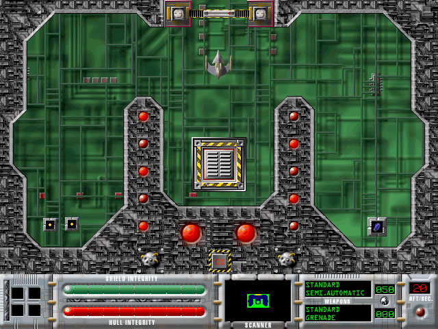

## A cyberfighter in the maze

ShadowWraith's original two-level demo sends a fighter through a network of
rooms, keys, enemies and teleporters. This is the promotional demo, with saving
disabled, rather than the full retail game.

The original 68K application has verified native movement. At startup, choose
**Change** for 256 colors, confirm the application's normal prompt, then choose
**New Game**. The default keypad controls use **8** to move forward, **5** to
reverse, **4/6** to rotate and **7/9** to strafe. Browser play remains pending.

